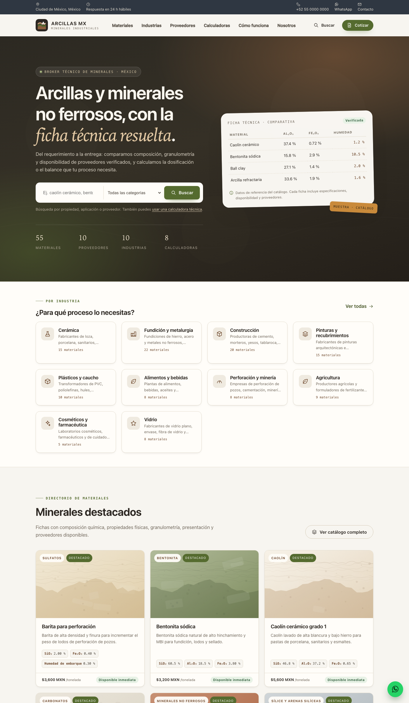
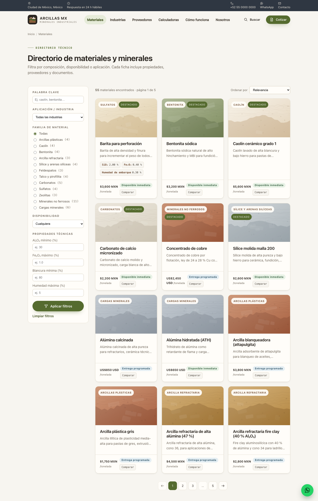
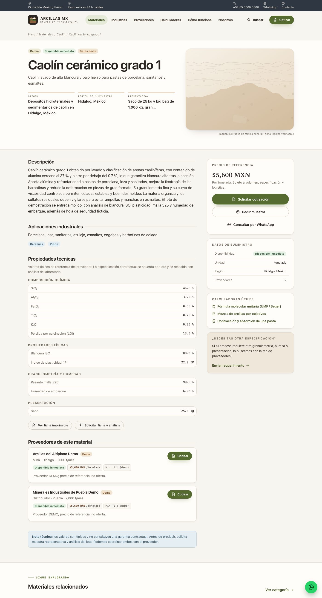
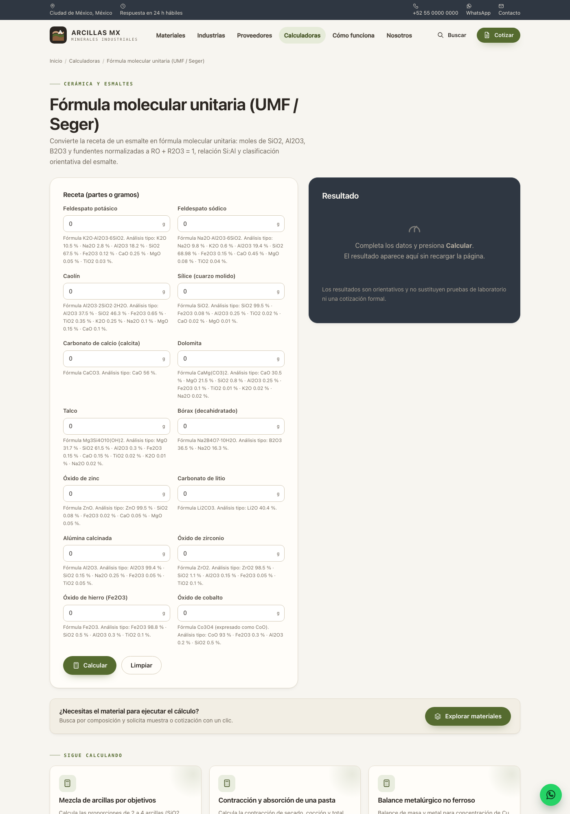
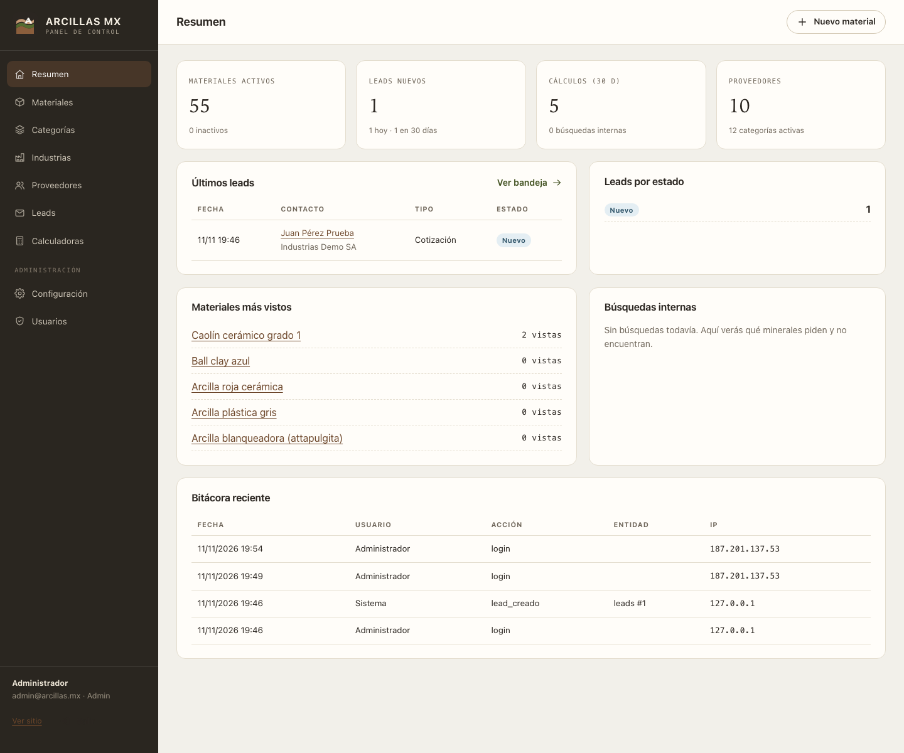
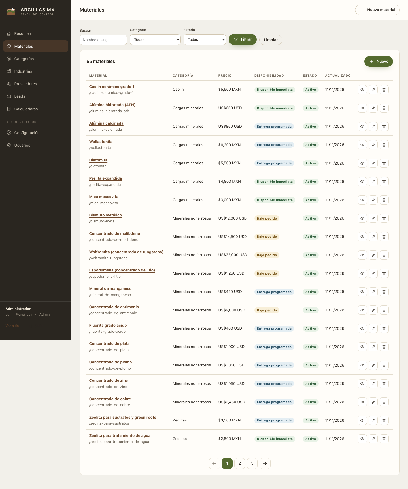
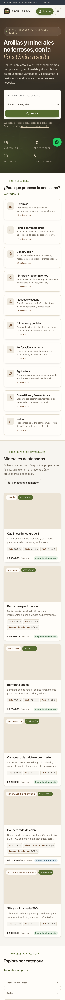

# Arcillas MX · Directorio técnico de arcillas y minerales no ferrosos

Sitio B2B en **PHP 8.3 + MySQL/MariaDB** para **ARCILLAS PROTEÍNAS Y DESARROLLOS GARCÍA**
(RFC APD200702M63), operado como broker de arcillas, minerales industriales y
concentrados no ferrosos en México.

La arquitectura del directorio replica el modelo de **UL Prospector** (industria →
categoría → ficha de material con datos técnicos → proveedor → comparación → solicitud
de muestra/cotización), adaptado a un broker mexicano y con una capa diferencial:
**8 calculadoras técnicas públicas** de formulación, proceso y comercio.

| | |
|---|---|
| **Demo en producción** | <https://floralwhite-meerkat-876567.hostingersite.com> |
| **Dominio previsto** | `https://arcillas.mx` (pendiente de apuntar DNS, ver despliegue) |
| **Panel** | `/admin/login` |
| **Admin demo** | `admin@arcillas.mx` · `ArcillasAdmin2026$` — **cambiar antes de operar** |
| **Código** | <https://github.com/Mikato8/arcillas> |

> ⚠️ Los proveedores, materiales, precios y certificaciones del catálogo inicial son
> **datos de demostración** (`es_demo = 1`), construidos con rangos típicos de literatura
> pública. Deben sustituirse por información real del broker antes de operar
> comercialmente. Los precios son referencias de mercado, no ofertas.

---

## Capturas

| Portada | Catálogo con facetas |
|---|---|
|  |  |

| Ficha técnica de material | Calculadora UMF |
|---|---|
|  |  |

| Panel · resumen | Panel · materiales |
|---|---|
|  |  |

| Móvil · portada |
|---|
|  |

---

## Qué incluye

### Sitio público

- **Portada** con propuesta de valor, buscador, industrias, materiales destacados,
  categorías, calculadoras, proceso de intermediación y CTAs.
- **Directorio de materiales** (`/materiales`) con buscador facetado: palabra clave,
  categoría, industria, disponibilidad y rangos de propiedades técnicas
  (Al₂O₃ mínimo, Fe₂O₃ máximo, blancura mínima, humedad máxima, pH, MBI, D50).
- **Ficha de material** (`/materiales/{slug}`): descripción, aplicaciones, composición
  química, propiedades físicas, granulometría, presentación, proveedores, precio de
  referencia, disponibilidad, documentos y calculadoras relacionadas.
- **Ficha imprimible** (`/materiales/{slug}/ficha-tecnica`) lista para PDF.
- **Comparador** (`/comparar?ids=a,b,c`) de hasta 4 materiales con tabla lado a lado.
- **Industrias** (`/industrias`) y **proveedores** (`/proveedores`) con perfiles.
- **Calculadoras** (`/calculadoras`): 8 herramientas gratuitas, sin registro, con
  explicación de fórmulas y advertencias metodológicas.
- **Captación de leads**: contacto, soy comprador (requerimiento), soy proveedor
  (oferta), solicitud de cotización y solicitud múltiple de muestras.
- **Legal**: aviso de privacidad LFPDPPP base y términos y condiciones (con nota de
  revisión legal), 404/500/403 personalizadas, `robots.txt` y `sitemap.xml` dinámicos.
- **SEO**: títulos y meta únicos, canonical, Open Graph/Twitter Cards, Schema.org
  (Organization, Product), URLs amigables, lazy loading, HTTPS y redirección www.

### Calculadoras técnicas (`/calculadoras`)

| Slug | Calculadora | Qué resuelve |
|---|---|---|
| `umf-esmalte` | Fórmula molecular unitaria (UMF/Seger) | Receta de esmalte → moles de óxidos con **ΣRO = 1**, relación Si:Al, carácter y fundente dominante |
| `mezcla-arcillas` | Mezcla de arcillas por objetivos | Proporciones de 2–4 arcillas para alcanzar SiO₂/Al₂O₃/Fe₂O₃/LOI objetivo |
| `contraccion-absorcion` | Contracción y absorción | Contracción de secado, cocción y total, corrección de molde, absorción de agua |
| `balance-metalurgico` | Balance metalúrgico no ferroso | Recuperación, razón de concentración, masa de concentrado, metal fino y valor pagable |
| `bentonita-arena-verde` | Bentonita para arena verde | Dosificación de bentonita y agua por lote/tonelada, ajuste por humedad |
| `granulometria-stokes` | Granulometría y Stokes | D10/D50/D90, Cu, Cc, interpolación log-lineal y velocidad de sedimentación |
| `precio-normalizado` | Precio normalizado | Tonelada húmeda → seca, merma, flete, margen, IVA, costo landed y por unidad de óxido |
| `formula-estructural-arcillas` | Fórmula estructural | Óxidos → fórmula estructural de filosilicatos (O₁₀(OH)₈), carga de capa y clasificación |

Motor en `app/Services/Calculators/`, con contrato propio, validación declarativa y
**321 asserts** en `tests/calculators.php`. Fórmulas y fuentes documentadas en
[`docs/calculadoras/`](docs/calculadoras/README.md).

### Panel administrativo (`/admin`)

- Login con `password_hash`/`password_verify`, sesión segura, CSRF y rate limiting.
- Roles **admin** y **editor**.
- Dashboard con leads, cálculos, búsquedas internas y bitácora.
- CRUD de materiales con propiedades técnicas (EAV), proveedores, industrias,
  categorías, imágenes y SEO por ficha.
- Bandeja de leads con filtros por tipo/estado/fecha, cambio de estado, notas internas
  y exportación CSV.
- Configuración del sitio (identidad, contacto, portada, comercial) y gestión de
  usuarios.
- `noindex` para todo el panel y bitácora de acciones en la tabla `logs`.

---

## Stack y estructura

- PHP **8.3** sin framework (compatible 8.2+), PSR-4 propio (`App\` → `app/`).
- MySQL/MariaDB con `utf8mb4`, **PDO + consultas preparadas** en toda la app.
- HTML5, CSS propio (sin CDN) y JavaScript vanilla (sin dependencias).
- Sin Composer ni `vendor/`: el envío SMTP está implementado con sockets y `MAIL_DRIVER=log`
  permite operar sin buzón configurado.

```text
arcillas/
├── app/
│   ├── Core/                 # Router, Request, Response, Database, Auth, Session, CSRF, Settings…
│   ├── Controllers/          # públicos + Admin/
│   ├── Models/               # Material, Categoría, Industria, Proveedor, Lead
│   ├── Services/             # Mailer + Calculators/ (motor de cálculo)
│   └── Views/                # layouts, parciales, páginas, admin
├── config/routes.php         # mapa de rutas
├── database/
│   ├── schema.sql            # 17 tablas, índices y FKs
│   ├── seed.php              # seeder idempotente (--dry-run / --force)
│   └── seed.sql              # catálogo portable generado
├── docs/
│   ├── investigacion/        # UL Prospector, 19 repos de calculadoras, fórmulas
│   ├── calculadoras/         # contrato, fórmulas y fuentes
│   ├── capturas/             # evidencia visual
│   ├── despliegue-hostinger.md
│   └── seguridad.md
├── public/                   # docroot: index.php, .htaccess, assets, uploads
├── resources/data/           # catalogo.json (fuente canónica del catálogo demo)
├── storage/                  # logs, caché de rate limit, uploads privados
├── tests/calculators.php     # runner de pruebas del motor
├── tools/                    # migrate, deploy, router de desarrollo, seed SQL
└── .env.example
```

### Base de datos (17 tablas)

`users`, `settings`, `industries`, `categories`, `materials`, `material_properties`
(EAV de fichas técnicas), `material_industries`, `material_suppliers`, `suppliers`,
`material_docs`, `leads`, `lead_items`, `logs`, `calculator_runs`, `search_logs`.
Esquema completo e índices en [`database/schema.sql`](database/schema.sql).

---

## Puesta en marcha local

Requisitos: PHP 8.2+ con `pdo_mysql`/`mbstring`, MySQL 8 o MariaDB 10.6+.

```bash
cp .env.example .env          # configura DB_HOST/PORT/NAME/USER/PASS y APP_URL
php tools/migrate.php --seed  # crea tablas y siembra el catálogo demo
php -S 127.0.0.1:8099 -t public tools/router.php
```

Abre <http://127.0.0.1:8099>. Panel: `/admin/login`.

Comandos útiles:

```bash
php tools/migrate.php --status     # tablas y conteos
php tools/migrate.php --fresh --seed  # BORRA y recrea (solo desarrollo)
php database/seed.php --force      # re-siembra sin tocar leads/usuarios
php tests/calculators.php          # 321 asserts del motor de cálculo
php -l app/Controllers/HomeController.php
```

---

## Despliegue

Ya está desplegado en Hostinger (PHP 8.3, MariaDB 11.8) detrás de
`floralwhite-meerkat-876567.hostingersite.com`. Guía completa, credenciales de
referencia, pasos SSH/rsync, correo SMTP, dominio y solución de problemas en
[`docs/despliegue-hostinger.md`](docs/despliegue-hostinger.md).

```bash
./tools/deploy.sh          # rsync + .env + permisos + verificación de BD
./tools/deploy.sh --status # conteos de la BD remota
./tools/smoke.sh           # prueba 30 rutas, protecciones, sitemap y calculadora
```

Checklist de seguridad y resultados de pruebas: [`docs/seguridad.md`](docs/seguridad.md).

### Pendientes para operar (no bloquean la demo)

1. **Cambiar contraseña del admin demo** y crear usuarios reales.
2. **Apuntar `arcillas.mx`** al hosting y actualizar `APP_URL` (hoy apunta al dominio de
   preview para que assets/canonical funcionen).
3. **Crear el buzón `contacto@arcillas.mx`** y pasar `MAIL_DRIVER=smtp` con su contraseña.
4. **Sustituir el catálogo demo** por materiales y proveedores reales (ver
   [`docs/datos-fuentes.md`](docs/datos-fuentes.md)).
5. **Revisión legal** del aviso de privacidad y términos (marcadores entre corchetes).
6. Respaldos automáticos de la base y del directorio `public/uploads`.

---

## Investigación: UL Prospector y repositorios de calculadoras

El proyecto nace de una búsqueda en repositorios de calculadoras de arcillas y
minerales no ferrosos y de replicar la arquitectura de UL Prospector:

- [`docs/investigacion/arquitectura-ulprospector.md`](docs/investigacion/arquitectura-ulprospector.md)
  — inventario de páginas y facetas (industria, compañía, tipo de materia prima,
  aplicación), anatomía de ficha de producto, proveedores, registro, mapa de rutas
  replicado y decisiones de UX/SEO. ULP bloquea el entorno (403) y prohíbe bots de IA;
  el análisis se hizo con snapshots de Wayback y solo se replicó estructura, no contenido.
- [`docs/investigacion/repositorios-calculadoras.md`](docs/investigacion/repositorios-calculadoras.md)
  — **19 repositorios reales verificados** (HTTP 200, API de GitHub, clonado e
  inspección de código): openglaze (MIT), MetalurgIA (MIT), GlazeHub, cone6-umf-pro,
  glazelab, PSD-Analyser, cipw, entre otros. Hallazgo clave: **no existe OSS** para
  dosificación de bentonita en arena verde ni para normalización de precio/humedad/
  costo landed; esas dos se construyeron con práctica industrial y normas (ASTM,
  Incoterms). El resto se implementó desde las fórmulas documentadas.
- [`docs/investigacion/formulas-referencias.md`](docs/investigacion/formulas-referencias.md)
  — fórmulas, variables, unidades, fuentes y casos numéricos resueltos de las 8
  calculadoras (usados como casos de prueba).

---

## Propiedad y contacto

© 2026 ARCILLAS PROTEÍNAS Y DESARROLLOS GARCÍA · RFC APD200702M63 · RESICO Personas
Morales · `contacto@arcillas.mx` · `arcillas.mx`. Código privado del cliente; los datos
técnicos del catálogo son de referencia y no constituyen garantía contractual.
